# String-Mixer

**Treat prompts as data — a set of ComfyUI nodes.**

The annoying part of prompting is rarely "I can't think of words". It's this: you want to switch one word off and see what happens, you want to change two words of what the upstream node just gave you, the same sentence lives in five different workflows, and you can never remember whether it's `from above` or `high angle`.

That's what these nodes are for: **split it, stitch it, gate it, clean it.**

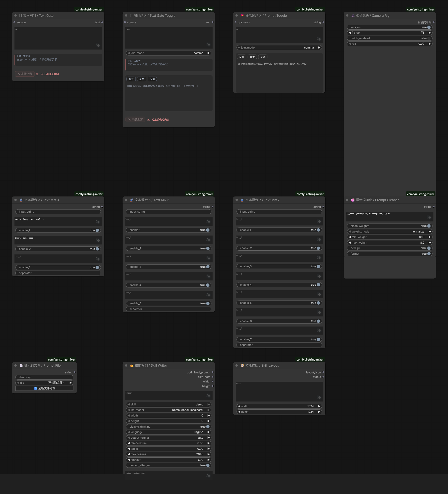

---

中文说明见 [README.md](README.md)

## Contents

Install · Node overview · Text Gate · Text Gate Toggle · Prompt Toggle · Text Mix 3/5/7 · Prompt Cleaner · Prompt File · Camera Rig · Skill Writer / Skill Layout · SkillPrompt setup · Notes

---

## Install

Drop it into `ComfyUI/custom_nodes/` and restart ComfyUI:

```bash
cd ComfyUI/custom_nodes
git clone https://github.com/Tsukihuyu/comfyui-string-mixer comfyui-string-mixer
```

- Frontend changes only need `Ctrl+Shift+R`; **Python changes require a ComfyUI restart**.
- Core nodes have no dependencies. The thumbnail in `📄 Prompt File` uses Pillow — it still works without it, just without downscaling.
- Every node lives under the **`String-Mixer`** right-click category; `SkillPrompt` is a subcategory.

---

## Node overview

| Node | What it does | When you'd reach for it |
|---|---|---|
| ⛩ **Text Gate** | Upstream text either passes through or gets replaced by yours | "The upstream text is fine except two words" |
| ⛩ **Text Gate Toggle** | Gate + per-segment switches (follows upstream until you touch it) | "Use part of what upstream gave me" |
| 💥 **Prompt Toggle** | Split one sentence into chips, toggle each | "Is this word even doing anything?" |
| 🧵 **Text Mix 3 / 5 / 7** | External input + N boxes, merged | "Keep quality, subject, outfit apart" |
| 🧼 **Prompt Cleaner** | Strip bracket spam, duplicates, extra spaces | "Pasted from somewhere messy" |
| 📄 **Prompt File** | Read a `.txt` from a folder | "I want prompts as files" |
| 🎥 **Camera Rig** | Pick a camera angle visually | "I can't remember the shot vocabulary" |
| ✍️ **Skill Writer** | Rulebook + LLM → finished prompt | "Fix the way prompts get written" |
| 🧭 **Skill Layout** | Structured layout → layout prompt | "Place things by numbers, not left/right" |

---

## ⛩ Text Gate

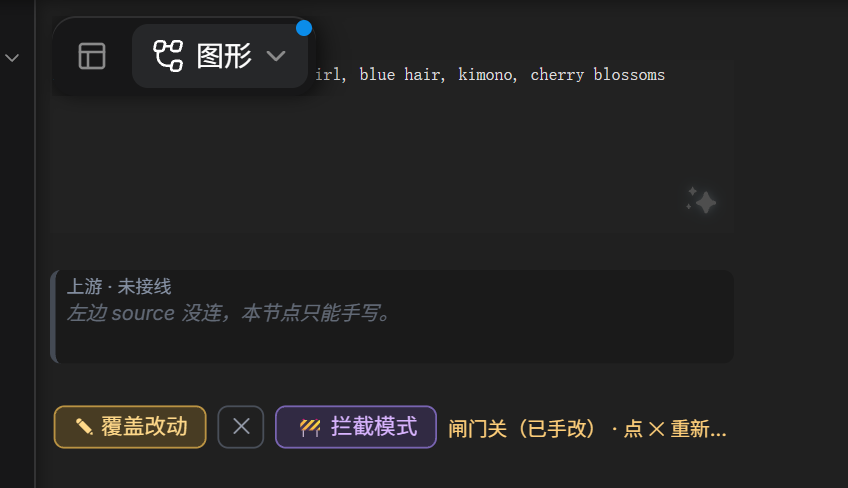

**The problem**: upstream (another node, an LLM, a file) hands you a prompt. You want to use it, but edit a few words. Before, that meant either editing upstream every time, or copy-pasting and maintaining two copies.

**Two rules only:**

- **Box empty → pass through.** When you queue, upstream text flows into the box and continues downstream.
- **Box has text → blocked.** Only what's in the box is output; upstream is held back. The status bar says how many characters were blocked and when upstream last ran.

**Why it's handy**: the box is both the display and the editor. What you see is exactly what downstream receives — there is no "shows one thing, outputs another". To go back to following upstream, hit `✕` to clear the box; no re-wiring.

**Actual behaviour**: upstream 81 characters, six segments typed in the box, those six go out:

```
upstream: masterpiece, best quality, 1girl, blue hair, kimono, cherry blossoms, smile, ...
output:   masterpiece, best quality, 1girl, blue hair, kimono, cherry blossoms
```

> "Last run" in the status bar is a real timestamp: it records what upstream was when the queue reached this node, so you can tell whether the snapshot is current.

---

## ⛩ Text Gate Toggle

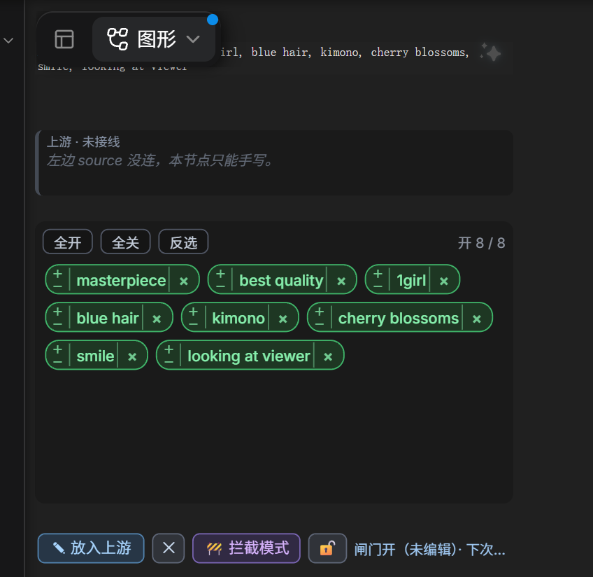

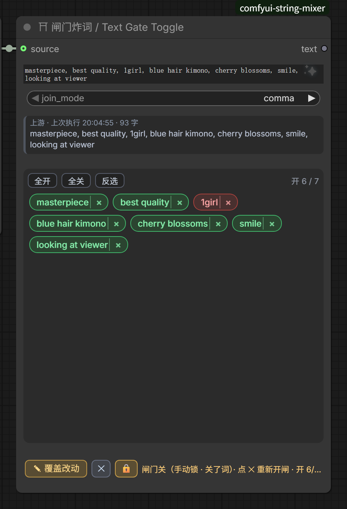

**The problem**: upstream gives a whole sentence; you want part of it this time, and maybe a different part next time.

**The gate opens on "did you touch it", not on "is the box empty"**:

- **Untouched** (no edits, no segments off, no lock) → every queue lets the new upstream in, and **this run's output is the new text**; the box refreshes with it. When upstream is an LLM writing fresh words each time, you never have to hit `✕` to re-open the gate.
- **Touched** (edited text / switched segments off / hit 🔒) → upstream gets blocked, only the box is output, and the status bar names the reason (`关了词`, `字改过`, `手动锁`, `手写内容`).

**Three details when untouched**:

- All-off then all-on counts as **untouched** — only the final state matters.
- Upstream gives nothing this run → **the old words stay**, with an explicit `上游这次是空的 · 旧词保留` note.
- Workflows saved before this version (no `tgs_base` record) are treated as **locked** — your hand-written box is never overwritten.

**🔒 Manual lock**: sometimes you just want to keep these words, without editing a character, and without them being replaced. One click locks; clicking again unlocks and accepts the current content as the new baseline.

**Splitting** (when the box has text): split on punctuation; all-on outputs the original text; with some off it re-joins per the join mode; **all-off outputs empty** and turns the counter red (so you never silently ship an empty prompt).

**Join modes**: `comma` re-joins with `", "`, `original` keeps the original punctuation.

**Green/red and `×` are different things**: clicking a chip only says "use it this round" (the word stays). Clicking the `×` at the right edge **deletes that segment from the text box for real**, punctuation included. An `Undo delete` button appears for 10 seconds afterwards. Deleting a segment counts as touching.

**Why it's handy**: one click flips between "everything upstream gave me" and "the subset I picked"; when you're done, `✕` or unlocking with 🔒 puts it back on follow. Off segments stay in place and turn red — **they are not deleted** — so switching one back on costs nothing.

**Actual behaviour**: 10 segments, 3 off

```
input:  masterpiece, best quality, 1girl, blue hair, kimono, cherry blossoms, smile, looking at viewer, shallow depth of field, cinematic light
output: masterpiece, best quality, 1girl, kimono, cherry blossoms, smile, cinematic light
```

---

## 💥 Prompt Toggle

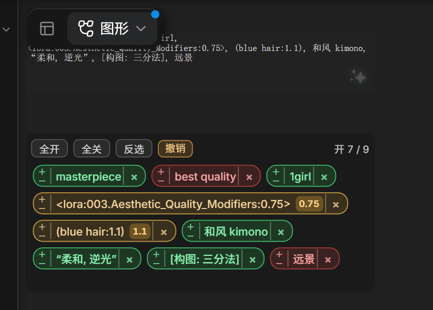

**The problem**: you wrote a prompt by hand and want to test, word by word, which parts actually matter.

**How it differs from Text Gate Toggle**: this node ignores upstream entirely — it's a plain word-splitter with switches. The upstream input is optional; when connected, it's prepended to your result (upstream verbatim, not affected by the switches).

**Why it's handy**: no copy-paste into another tool to compare. Off words stay put, and turning them back on restores the original sentence. To really remove one, use the `×` at the right edge of the chip (undoable for 10 seconds).

```
input:  masterpiece, best quality, 1girl, blue hair, kimono, cherry blossoms, smile, looking at viewer, shallow depth of field, cinematic light
off:    best quality / cherry blossoms / looking at viewer / shallow depth of field
output: masterpiece, 1girl, blue hair, kimono, smile, cinematic light
```

---

## 🧵 Text Mix 3 / 5 / 7

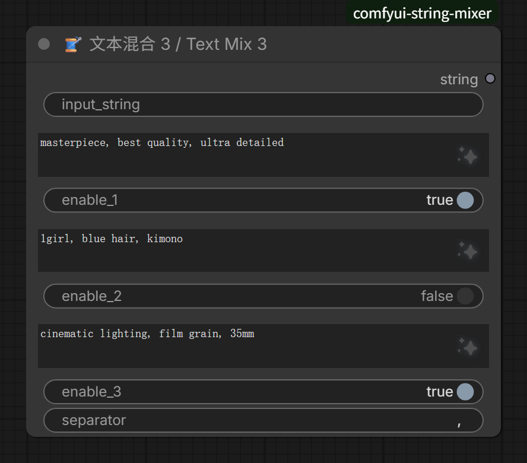

**The problem**: a prompt is always "quality words + subject + outfit + scene + lighting" glued together. Stuffed into one box, changing one part means searching through a long line.

**Rules**: order is fixed — **external input → box 1 → box 2 → …**; empty boxes are skipped, disabled boxes are skipped entirely; the separator defaults to a single space and can be set to `, `.

The three variants differ only in capacity (3 / 5 / 7 slots); merging is identical:

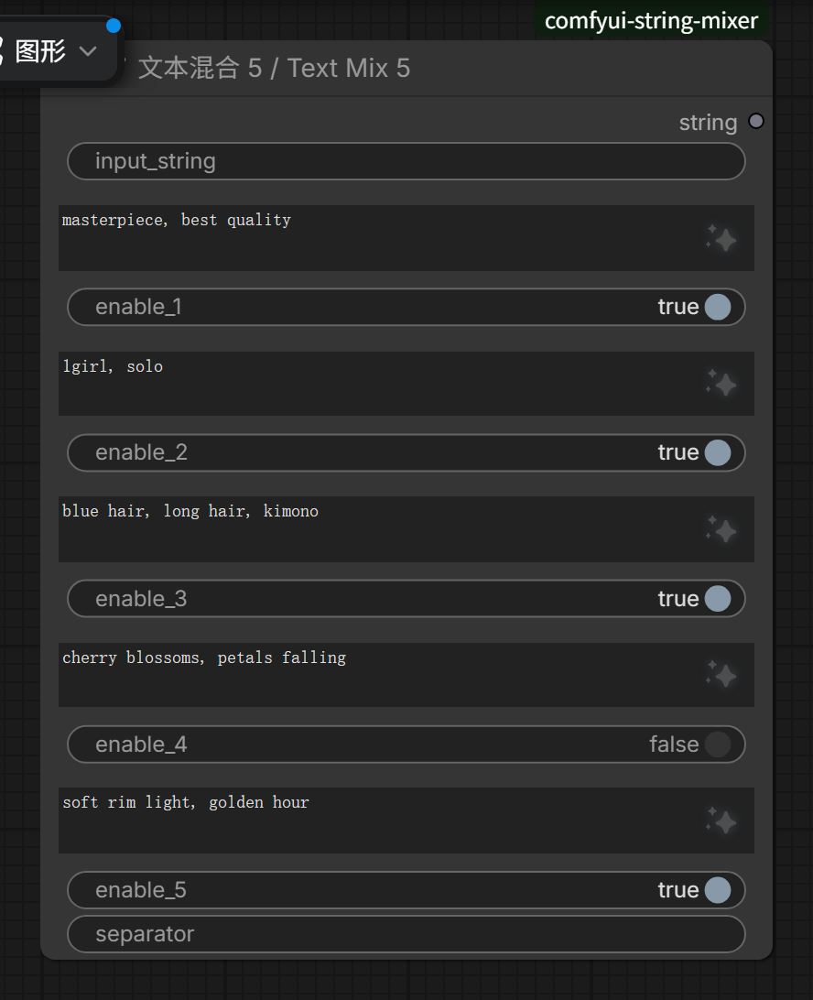
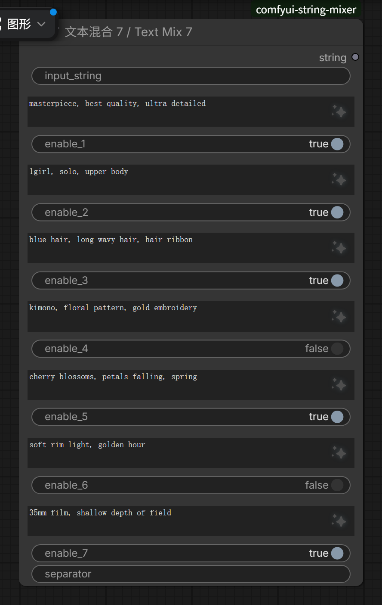

**Why it's handy**: changing the outfit touches only box 3; trying other lighting touches only box 7 and a toggle. **The same skeleton can be reused across workflows**, because every slot is stated explicitly.

```
external: (empty)
box 1: masterpiece, best quality
box 2: 1girl, blue hair        <- disabled
box 3: cherry blossoms, soft light
separator: ", "
output: masterpiece, best quality, cherry blossoms, soft light
```

---

## 🧼 Prompt Cleaner

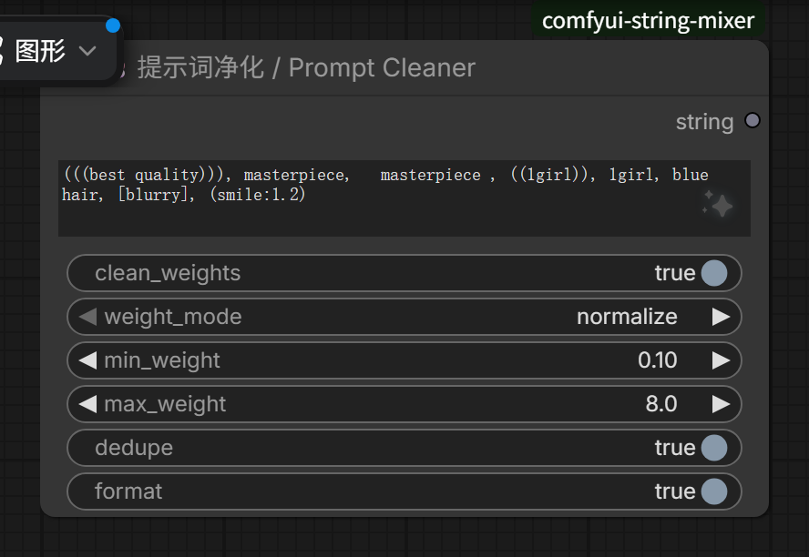

**The problem**: prompts copied from elsewhere arrive with `(((...)))`, duplicate words, triple spaces and square brackets. Feeding that to a model gives you blown-out or mushy results for no obvious reason.

**Four switches, four jobs**: weight handling (normalise into a range / strip all), duplicate removal, formatting (consistent commas and spaces), plus weight floor and ceiling.

**Why it's handy**: you don't need to remember the `(word:1.2)` syntax — tick a few boxes and get a clean line. And it **changes weights, not words**: the word stays, only its strength lands in a range you accept.

```
input:  (((best quality))), masterpiece,   masterpiece , ((1girl)), 1girl, blue hair, [blurry], (smile:1.2)
output: (best quality:1.21), masterpiece, (1girl:1.1), blue hair, (blurry:0.9), (smile:1.2)
```

---

## 📄 Prompt File

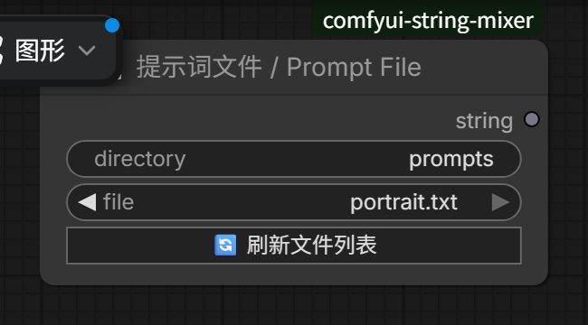

**The problem**: your good prompts are scattered across chat logs, notes and `.txt` files; every use is a copy-paste hunt.

**How to use**: put a folder in `directory` (relative to ComfyUI's `input/`; empty means `input/prompts`), pick a `.txt` from the `file` dropdown. If a same-named image sits next to it, hovering the node shows a thumbnail.

**Why it's handy**: a prompt becomes a **file** — version-controlled, shareable, and reusable across workflows. Edit the file, and every workflow using it changes.

---

## 🎥 Camera Rig

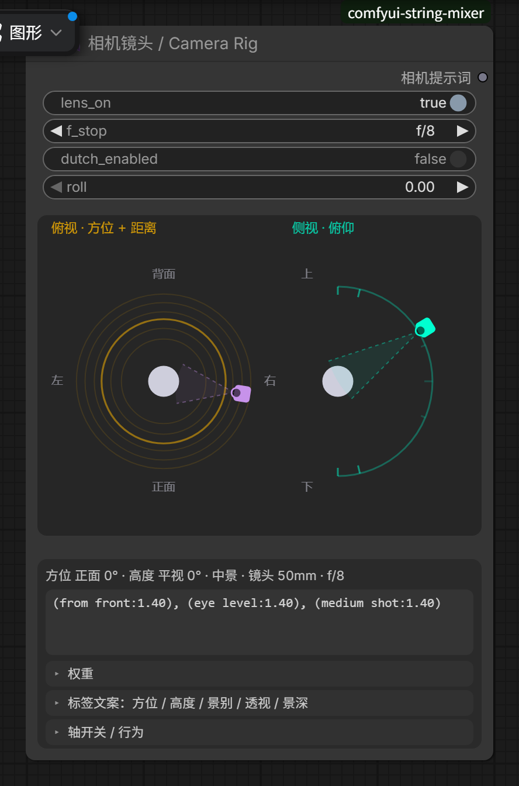

**The problem**: camera language is the worst offender for template phrases — `from above`, `high angle`, `cowboy shot`, `85mm`. Easy to forget, and a wrong one is invisible until you look at the picture.

**How to use**: the left side is a drag-able top-down camera diagram; the right side groups by **azimuth / elevation / shot size / perspective / aperture / tilt**. **The preview line is the exact line that gets queued**, not a reference value.

**Why it's handy**: what you see is what you get. You adjust "from the right, slightly high, medium shot"; the node emits weighted camera phrases. Weight mode can be "conservative cap" or "bare words".

```
azimuth = right, elevation = slightly high, shot = medium, focal 50mm
output: (from front:1.05), (from right:1.35), (high angle:1.14), (from above:1.14), (cowboy shot:1.40)
```

---

## ✍️ Skill Writer / 🧭 Skill Layout

These two come from the `skillprompt` subpackage — the "let an LLM write prompts under fixed rules" half. Every other node here is offline; only these need an endpoint.

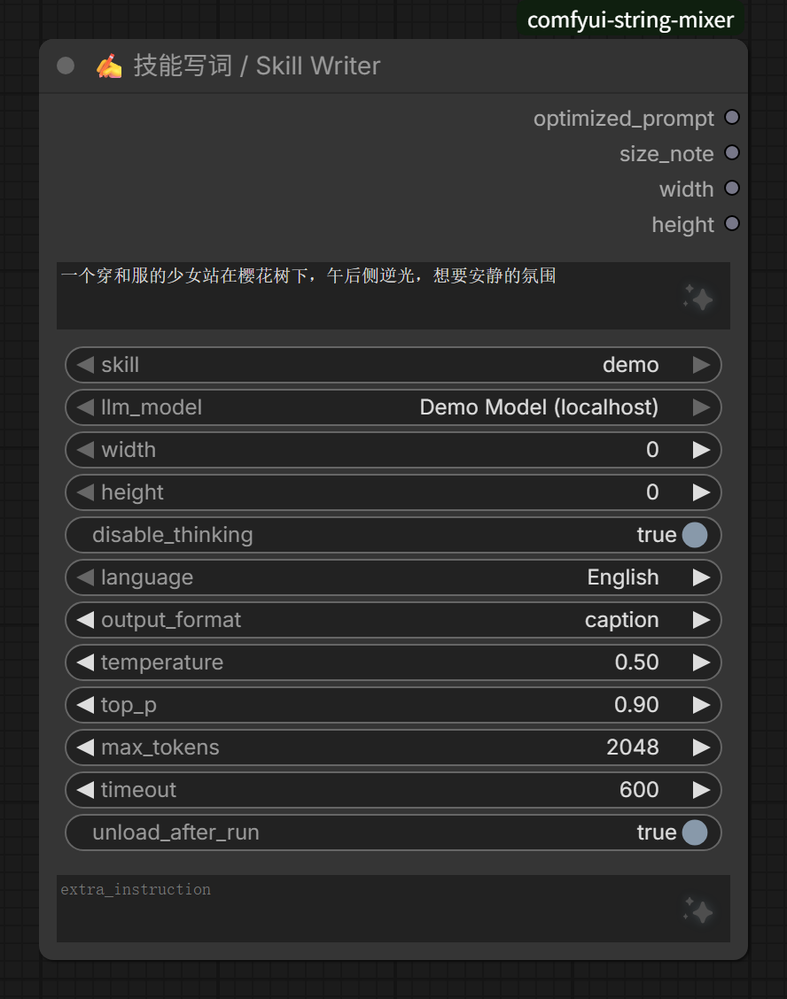

**Skill Writer**: you describe what you want in plain language (Chinese works), and it writes the prompt following the selected rulebook (`SKILL.md`) and output format (`caption` / `tag` / `layout`). The rulebook decides *how*; the node decides *which model*.

**Why it's handy**: it moves prompt style out of your muscle memory and into a file. Change the rulebook and every workflow using it changes with it.

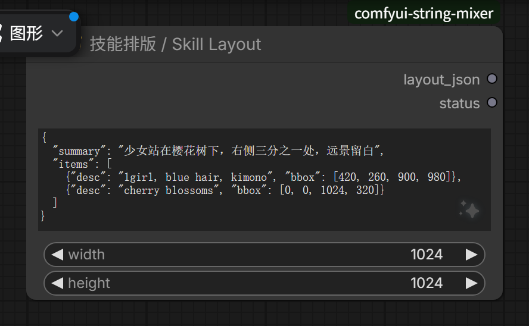

**Skill Layout**: local only, no network. Takes a structured layout (`summary` + a `box` per element) and emits one line of precisely placed layout prompt — positions as numbers, not vague `left / right / center`.

---

## SkillPrompt setup

The `skillprompt` subpackage needs two things.

**1. An OpenAI-compatible endpoint**

```bash
cp skillprompt/skillprompt.ini.example skillprompt/skillprompt.ini
```

```ini
[lmstudio]
name = LM Studio 8B
base_url = http://127.0.0.1:1234/v1
model = qwen3-8b-instruct
```

Each `[section]` becomes one entry in the dropdown; restart ComfyUI after editing.

> `skillprompt.ini` holds addresses and possibly keys. **It is git-ignored — never commit it.**

**2. Rulebooks**

```
skillprompt/skills/<name>/SKILL.md
```

One folder per rulebook; the dropdown shows the folder name. The bundled `skillprompt/skills/demo/SKILL.md` is an **empty file** that only demonstrates the structure — write your own content to actually use it.

---

## Notes

- **Node type names are stable** (`StringMixer`, `TextGateSplit`, …), so existing workflows keep loading. Only display names changed.
- **Both gates are output nodes**: selecting one and hitting Queue runs just it and its upstream; the others run with whatever consumes them.
- **State travels with the workflow**: text typed into a gate, which segments are off, camera parameters — all live in node properties and are saved in the workflow `.json`.
- **The gate remembers whether you touched it**: the text it last absorbed lives in the `tgs_base` node property, so a page refresh or a reopened workflow still knows whether to follow upstream.
- **Hitting `✎` while the queue is busy is refused outright**: the status bar says 「前序任务还没跑完 · 稍后再试」. It does not sneak into the queue and does not retry later on its own — opening the gate means running upstream, which competes for the same resources.
- **Python changes need a restart; frontend changes need `Ctrl+Shift+R`.** If unsure, do both.
- **The README images are real screenshots taken by a script**: `node tools/shots/shoot.mjs` re-shoots everything (ComfyUI on `127.0.0.1:8199`), or a single scene with `node tools/shots/shoot.mjs 02-gate-toggle`.

## License

MIT
