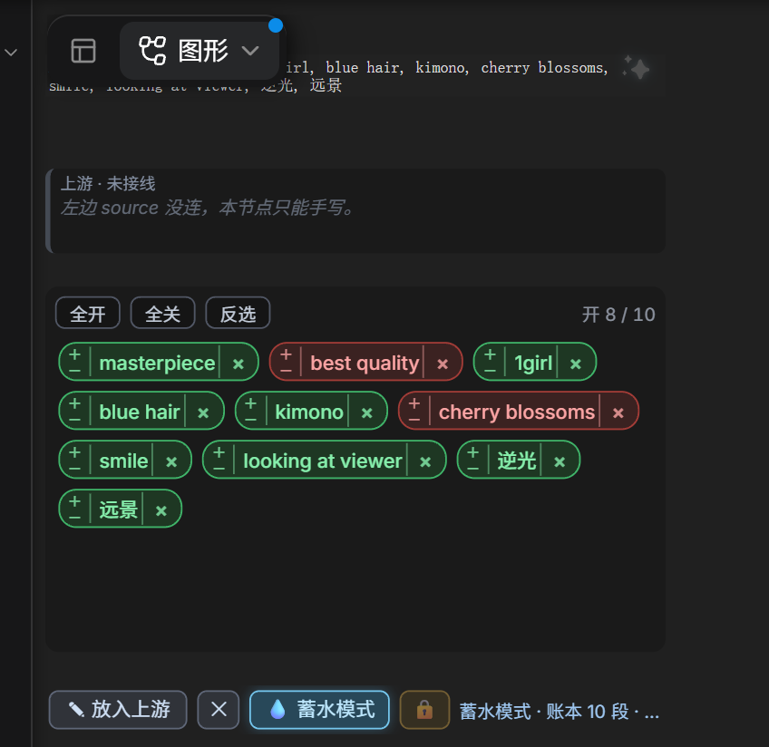

# String-Mixer

**Let AI generate. Let humans compose.**

A text-processing and prompt-orchestration toolkit for ComfyUI.

It started from a simple thought: why does editing a prompt always mean hunting through one long text box, copying, and deleting?

So the text mixer came first, then prompt splitting, the text gate, and the combinations between them.

Today you can split a prompt into individual chips and enable or disable each one; you can receive whatever an LLM generates and take over the input whenever you want, keeping your own edits; and you can combine text from different sources into a prompt workflow of your own.

The project also includes prompt cleaning, file-based prompts, a visual camera rig, and skill-driven prompt helpers.

All of it does four things: **split, join, hold back, clean up**.

It is a small toolkit that grew out of real use. I hope it makes your ComfyUI workflows a little smoother.

中文：[README.md](README.md)

---

## Changelog

### 1.3.0 — chips became editable, and pinnable

- **Edit a chip in place**: double-click a chip and it turns into a wrapping editor that grows with the text (long segments are no longer squeezed into a narrow slit). Only that segment is replaced; every other character stays put. `Esc` cancels, clearing deletes it.
- **Insert in empty space**: double-click between chips, after the last chip of a row, or in the empty area below them to add a new segment at the nearest gap; a thin line marks the insertion point on hover.
- **Per-chip lock**: the small padlock at the far left (cyan = pinned, grey-green = free). A pinned segment cannot be deleted with ×, emptied by hand, removed by ✕ clear, overwritten by an upstream text, or duplicated by reservoir absorbing. Locking never forces output — a pinned segment that is switched off still stays out of the result.
- **Colour fade**: the on/off switch fades between green and red over 0.28 s.
- **Fixes**: the Text Gate Toggle node grew by 12 px on every layout pass on some frontends; long chips collapsed into a one-line editor; chip gaps 6 px → 8 px.

Older versions: [commit history](https://github.com/Tsukihuyu/comfyui-string-mixer/commits/main).

---

## Contents

Install · Node overview · Text Gate · Text Gate Toggle · Prompt Toggle · Text Mix 3/5/7 · Prompt Cleaner · Prompt File · Camera Rig · Skill Writer / Skill Layout · SkillPrompt setup

---

## Install

Drop it into `ComfyUI/custom_nodes/` and restart ComfyUI:

```bash
cd ComfyUI/custom_nodes
git clone <this repository> comfyui-string-mixer
```

- Front-end changes only need `Ctrl+Shift+R`; **Python changes need a ComfyUI restart**.
- The core nodes have no dependencies; the thumbnails in `📄 Prompt File` use Pillow (it still works without it, just without thumbnails).
- Everything lives under the **`String-Mixer`** category in the right-click menu, with `SkillPrompt` as its subcategory.

---

## Node overview

| Node | What it does | When you reach for it |
|---|---|---|
| ⛩ **Text Gate** | Upstream text: let it through, replace it with yours, or accumulate it | "I want to change a couple of words upstream gave me" |
| ⛩ **Text Gate Toggle** | Gate + per-chip switches (follows upstream until you touch it) | "Use part of what upstream gave me" |
| 💥 **Prompt Toggle** | Split one sentence into chips; toggle, weight, reorder | "Is this word even doing anything?" |
| 🧵 **Text Mix 3 / 5 / 7** | External input + N boxes, merged | "Keep quality, subject, outfit apart" |
| 🧼 **Prompt Cleaner** | Strip stray brackets, duplicates, extra spaces | "A dirty prompt pasted from somewhere" |
| 📄 **Prompt File** | Read a .txt from a folder | "I want prompts managed as files" |
| 🎥 **Camera Rig** | Visual camera placement → shot language | "I can't remember *from above* and friends" |
| ✍️ **Skill Writer** | Rulebook + LLM → finished prompt | "Fix the rules of how to write" |
| 🧭 **Skill Layout** | Structured layout → layout prompt | "Positions by numbers, not left/right" |

---

# Node details

## ⛩ Text Gate


**Switch freely between upstream input and your own edits.**

When an upstream node, an LLM or a file hands you a block of text and you only want to change part of it, there is no need to copy the whole thing — and no need to go back and edit upstream.

Text Gate gives you an editable box:

- **Pass through automatically**: when the box is empty, upstream text is received and passed on as-is.
- **Take over manually**: once you type into the box, upstream is held back and your text is what goes out.
- **Follow again**: clear the box and upstream flows through once more.
- **Reservoir mode**: every time upstream produces something, only the words you have *not absorbed yet* are appended to the end of the box — never blocked, never removed.

The box is both the display and the editor. What you see is exactly what downstream receives.

The mode button in the status bar flips between `🚧 拦截模式` (purple) and `💧 蓄水模式` (water blue). In reservoir mode upstream simply accumulates: if upstream inserts one word in the middle, only that word is absorbed; repeats are not absorbed twice. Absorbed words are remembered in the node properties and saved with the workflow; clearing the box clears that record too, so upstream can fill it again. Reservoir mode ignores "did you touch it" and the manual lock entirely.

It suits workflows that switch between dynamic text and hand edits — and workflows where each new generation from upstream slowly builds up one long prompt.

**In practice**: upstream is 81 characters, you type six segments, those six go out.

```
upstream: masterpiece, best quality, 1girl, blue hair, kimono, cherry blossoms, smile, ...
output:   masterpiece, best quality, 1girl, blue hair, kimono, cherry blossoms
```

> "Last run" in the status bar is a real timestamp: it records what upstream was when the queue reached this node, so you can tell whether the snapshot is current.

---

## ⛩ Text Gate Toggle


**Let a dynamically generated prompt be edited and controlled word by word.**

This is Text Gate combined with Prompt Toggle. It receives upstream text *and* splits it into chips, so you can pick which pieces actually reach the output.

Its defining behaviour: **the node decides by whether you have interfered with the text, not merely by whether the box is empty.**

- **Follow automatically**: untouched text is replaced by the latest upstream text on every run.
- **Per-chip switches**: click a chip to enable or disable it; a disabled chip stays in place and can be switched back on. The switch fades between green and red (0.28 s), so you can see the node react.
- **Edit a chip in place**: double-click a chip and it becomes an input box; Enter (or clicking elsewhere) replaces only that segment — every other character and delimiter stays put. `Esc` cancels, clearing it deletes the segment.
- **Insert on double-click in empty space**: double-click the empty space next to the chips (between them, at the end of a row, or below them) and a new segment is inserted at the nearest gap — on by default, and only one delimiter is added. Hovering the empty space shows a thin line marking the insertion point.
- **Per-chip lock**: the small padlock at the far left of a chip is the highest authority. A pinned segment cannot be deleted with ×, emptied by hand, removed by the ✕ clear, overwritten by an upstream text, or duplicated by reservoir absorbing. Locking protects against deletion only — it does not force the segment into the output. When new text arrives, a pinned word follows the new text's position if present there, and is appended to the very end if absent.
- **Chip weight**: `＋` / `－` on the left of a chip adjusts its weight and writes the result into the text box; a LoRA segment has its own strength field adjusted instead.
- **Drag to reorder**: hold a chip, drag it, release — the text box is reordered and the switch and weight travel with that word.
- **Edit by hand**: changing the text or deleting a chip puts the node into manual takeover.
- **Manual lock**: lock the current text even without editing it, so later upstream updates cannot overwrite it.
- **Follow again**: unlock or reset the interference and upstream flows in once more.

Both a comma join and an original-punctuation join are supported, with special handling for colon labels like `Style:` / `Subject:` and for ratio and weight syntax; balanced punctuation (`<lora:…>`, `[a, b]`, `《…》`, quotes and friends) is kept whole so nothing inside it is split.

The same mode button lives here: switch to `💧 蓄水模式` and new upstream words accumulate run after run instead of overwriting what you have edited.



It suits most prompts that arrive from upstream: you keep the automation and still step in whenever the result needs adjusting.

**In practice**: three of ten segments switched off.

```
input:  masterpiece, best quality, 1girl, blue hair, kimono, cherry blossoms, smile, looking at viewer, shallow depth of field, cinematic light
output: masterpiece, best quality, 1girl, kimono, cherry blossoms, smile, cinematic light
```

---

## 💥 Prompt Toggle


**Split a whole prompt into chips you can control independently.**

Testing whether a word actually affects the result no longer means copying, deleting and restoring the whole block of text.

Prompt Toggle recognises independent segments and turns them into interactive chips:

- **Enable/disable per chip**: click a chip to decide whether it takes part in the output.
- **Edit in place**: double-click a chip to rewrite that one segment; `Esc` cancels, clearing it deletes the segment.
- **Insert in the empty space**: double-click the gap between chips to add a new segment there (on by default).
- **The text is kept**: a disabled chip is not deleted; switch it back on and it returns.
- **Delete for real**: remove a chip you no longer want, with a short undo window.
- **Chip weight**: `＋` / `－` on the left add or subtract 0.05; a bare word becomes `(blue hair:1.15)` and goes back to bare form at 1.00.
- **Drag to reorder**: hold a chip, drag it, release; the switch and weight follow that word.
- **Flexible rejoin**: comma join or original-punctuation join.
- **Syntax protection**: colon labels, numeric ratios and weight expressions are recognised, and balanced punctuation (brackets, book-title marks, quotes, `<lora:…>`) is kept whole — a tag like `<lora:003.Aesthetic_Quality_Modifiers:0.80>` is never torn apart.

You can edit only the text inside the node, or connect upstream text and have it prepended verbatim to the result.

It suits testing prompts one item at a time, adjusting tag combinations, and fine control over what an image model reads.

```
input:  masterpiece, best quality, 1girl, blue hair, kimono, cherry blossoms, smile, looking at viewer, shallow depth of field, cinematic light
off:    best quality / cherry blossoms / looking at viewer / shallow depth of field
output: masterpiece, 1girl, blue hair, kimono, smile, cinematic light
```

---

## 🧵 Text Mix 3 / 5 / 7


**Break a prompt into independent modules and combine them as needed.**

A complete prompt usually carries quality words, subject, outfit, environment and lighting. Keeping all of that in one text box makes both editing and reuse awkward.

Text Mix gives you 3, 5 or 7 separate text boxes, managed independently and joined in a fixed order into one prompt.

- **Edit separately**: each box is written and edited on its own.
- **Switch separately**: turn a module off without touching the rest.
- **External input**: receive upstream text and put it at the front of the result.
- **Custom separator**: space, comma, or whatever you prefer.
- **Three sizes**: pick 3, 5 or 7 boxes depending on the workflow.

It suits modular, reusable prompt sets shared across workflows and generation tasks.

**Why it helps**: changing an outfit means editing one box; trying different lighting means editing another and toggling it. **The same skeleton is reusable across workflows**, because every box says plainly what it holds.

```
external: (empty)
box 1: masterpiece, best quality
box 2: 1girl, blue hair        ← off
box 3: cherry blossoms, soft light
separator: ", "
output: masterpiece, best quality, cherry blossoms, soft light
```

---

## 🧼 Prompt Cleaner


**Clean up redundant formatting so the text stays consistent.**

Prompts copied from other models, workflows or reference material often arrive with duplicate words, redundant brackets, stray spaces and inconsistent weight syntax.

Prompt Cleaner handles all of that in one place:

- **Weight handling**: normalise weights, or strip weight expressions entirely.
- **Duplicate removal**: find and drop repeated prompts.
- **Formatting**: unify commas and spacing.
- **Weight range**: clamp weights to a floor and ceiling so nothing runs away.

Each step can be switched on independently.

It suits imported prompts, complicated weight expressions, and normalising text inputs across a workflow.

```
input:  (((best quality))), masterpiece,   masterpiece , ((1girl)), 1girl, blue hair, [blurry], (smile:1.2)
output: (best quality:1.21), masterpiece, (1girl:1.1), blue hair, (blurry:0.9), (smile:1.2)
```

---

## 📄 Prompt File


**Keep prompts as files and share them between workflows.**

Prompts you use often are better stored as plain text files than copied into yet another workflow.

Prompt File reads `.txt` files from a chosen folder and lets you pick one from a dropdown.

- **Folder read**: read prompt files from a folder inside ComfyUI's input directory.
- **Quick switching**: choose a different file from the dropdown.
- **Thumbnail preview**: if an image with the same name exists, hovering previews it.
- **Affix presets**: plain text, MOSS, Krea2 and custom affix formats.
- **Reuse**: the same file can be read by many workflows; edit the file and every reader updates.

It suits managing common prompt templates, character descriptions and style presets without scattering them across workflows.

**Why it helps**: a prompt becomes a **file** — versionable, shareable, and shared by several workflows at once. Edit the file and every reference follows.

---

## 🎥 Camera Rig


**Control camera parameters visually and get the matching English shot description.**

Shot language is full of English you have to memorise: `from above`, `high angle`, `cowboy shot`, `85mm`. Hand-writing it is both hard to remember and hard to judge before you see the result.

Camera Rig puts the usual camera parameters into one visual panel:

- **Placement**: drag on the diagram to set the viewing direction.
- **Height**: pick pitch and shooting height.
- **Shot size**: close-up, medium shot, wide shot and the rest.
- **Perspective and focal length**: set perspective and lens.
- **Tilt**: adjust the roll of the frame.
- **Weight mode**: weighted shot description, or bare tags.

The node previews the exact text it will emit when the queue runs it.

It suits people who do not know English shot terms by heart, and anyone who wants precise, visible control over composition inside a workflow.

**Why it helps**: what you see is what you get — you pick "from the right, slightly high, medium shot", the node emits the weighted shot words; the weight mode can be a safe cap or bare words.

```
azimuth = right, height = slightly high, shot size = medium, focal 50mm
output: (from front:1.05), (from right:1.35), (high angle:1.14), (from above:1.14), (cowboy shot:1.40)
```

---

## ✍️ Skill Writer

**Have an LLM write prompts according to rules you define.**

Every model and workflow expects its own prompt format, structure and phrasing. Rather than rewriting the prompt — or re-describing the rules — every time, keep those requirements in a rulebook.

Skill Writer calls an OpenAI-compatible endpoint with your input, the rulebook and the requested output format.

- **Custom rulebooks**: define generation rules in `SKILL.md`.
- **Multiple skills**: keep several rulebooks and switch between them.
- **Output formats**: Caption, Tag and Layout modes.
- **Any endpoint**: manage OpenAI-compatible endpoints in a config file.
- **Reuse**: edit the rulebook and every workflow using it follows.

The rulebook defines the standard; the node calls the model and assembles the input.

It suits building your own prompt-writing standard, so the LLM produces text suited to your models and workflows.

---

## 🧭 Skill Layout

**Turn a structured layout into precise positional prompt text.**

Describing a layout in natural language — `left`, `right`, `center` — is imprecise and ambiguous.

Skill Layout does not use an LLM at all: it reads structured layout data and converts element positions into prompt text.

- **Structured input**: layout data with a `summary` and per-element `box` coordinates.
- **Numeric positioning**: describe positions with coordinates and sizes.
- **Automatic wording**: organise the layout into text an image model can use.
- **Local only**: no API, no network, no extra model call.

It suits turning visual layout analysis into prompt text, so the model understands how several subjects relate to each other in the frame.

---

## SkillPrompt setup

The `skillprompt` subpackage needs two things.

**1. An OpenAI-compatible endpoint**

```bash
cp skillprompt/skillprompt.ini.example skillprompt/skillprompt.ini
```

```ini
[lmstudio]
name = LM Studio 8B
base_url = http://127.0.0.1:1234/v1
model = qwen3-8b-instruct
```

Each `[section]` becomes one entry in the dropdown; restart ComfyUI after editing it.

> `skillprompt.ini` holds addresses and possibly keys, **it is in `.gitignore` — do not commit it**.

**2. A rulebook**

```
skillprompt/skills/<name>/SKILL.md
```

One folder per rulebook, shown in the dropdown by folder name. The bundled `skillprompt/skills/demo/SKILL.md` is an **empty file** that only demonstrates the layout — write your own content to actually use it.

---

## License

MIT
