# String-Mixer

**把提示词当成数据来处理的一套 ComfyUI 节点。**

写提示词时最烦的其实不是"想不出词"，而是这些：一个词想临时关掉试试、上游给的东西想改两个字、同一句话在五个工作流里各改一遍、镜头语言永远记不住英文模板。

这套节点干的就是这些活：**拆开、拼起、拦住、洗干净**。

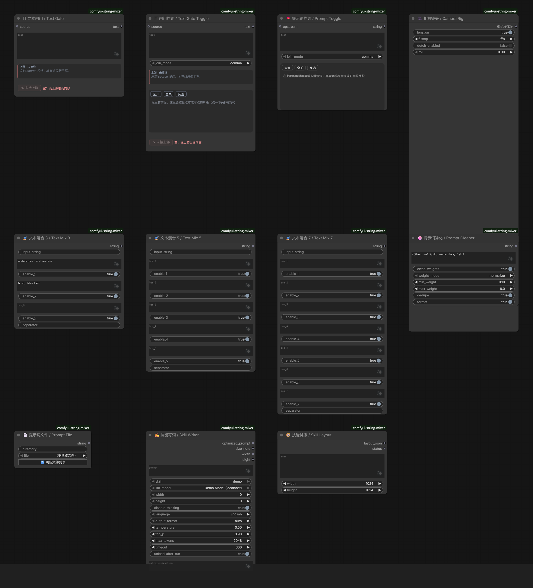

English: [README.en.md](README.en.md)

---

## 目录

安装 · 节点一览 · 文本闸门 · 闸门炸词 · 提示词炸词 · 文本混合 3/5/7 · 提示词净化 · 提示词文件 · 相机镜头 · 技能写词/排版 · SkillPrompt 配置 · 注意事项

---

## 安装

放到 `ComfyUI/custom_nodes/` 下，重启 ComfyUI：

```bash
cd ComfyUI/custom_nodes
git clone <本仓库地址> comfyui-string-mixer
```

- 前端改动只需 `Ctrl+Shift+R`；**Python 改动必须重启 ComfyUI**。
- 核心节点零依赖；`📄 提示词文件` 的缩略图用到 Pillow（没有也能用，只是不缩图）。
- 所有节点在右键菜单的 **`String-Mixer`** 分类里，`SkillPrompt` 是它的子分类。

---

## 节点一览

| 节点 | 作用 | 一句话场景 |
|---|---|---|
| ⛩ **文本闸门** / Text Gate | 上游进来的字，要么放行，要么换成你写的 | "上游给的我想改两个字" |
| ⛩ **闸门炸词** / Text Gate Toggle | 闸门 + 逐词开关 | "在这批词里挑一部分用" |
| 💥 **提示词炸词** / Prompt Toggle | 一句话拆成词片，逐片开关 | "这个词先关掉试试" |
| 🧵 **文本混合 3 / 5 / 7** / Text Mix | 外部输入 + N 个格子合并 | "质量词、主体、服装分开管" |
| 🧼 **提示词净化** / Prompt Cleaner | 去乱括号、重复词、多余空格 | "从别处复制来的脏提示词" |
| 📄 **提示词文件** / Prompt File | 从目录读 .txt | "提示词想当文件管" |
| 🎥 **相机镜头** / Camera Rig | 可视化选机位，出镜头语言 | "记不住 from above 这些" |
| ✍️ **技能写词** / Skill Writer | 规则书 + LLM 写出成稿 | "把怎么写的规矩固定下来" |
| 🧭 **技能排版** / Skill Layout | 结构化布局 → 布局提示词 | "位置用数字定，不靠 left/right" |

---

## ⛩ 文本闸门 / Text Gate

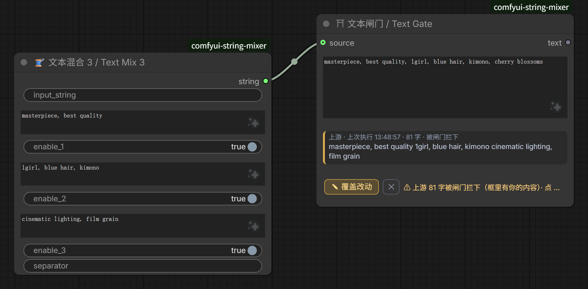

**它解决的问题**：上游（另一个节点、LLM、文件）给了一段词，你想用，但想改几个字。以前要么每次手改上游，要么整段复制过来自己维护两份。

**规则只有两条**：

- **框里空着 → 放行。** 排队时上游原文会流进框里，同时作为输出往下走。
- **框里有字 → 拦截。** 只输出框里的字，上游被挡在外面；状态条会写明被拦了多少字、上游是什么时候的。

**方便在哪**：这个框**既是显示区也是编辑区**。你看到的字，就是下游会收到的字——不存在"显示一套、输出另一套"。想恢复跟随上游，点 `✕` 清空框即可，不用重新连线。

**实际效果**：上游 81 字，框里写了 6 段，输出就是框里这 6 段：

```
上游：masterpiece, best quality, 1girl, blue hair, kimono, cherry blossoms, smile, ...
输出：masterpiece, best quality, 1girl, blue hair, kimono, cherry blossoms
```

> 状态条里的"上次执行"是真时间：它记录的是队列跑到这个节点时的上游内容，所以你能判断"这份快照是不是最新的"。

---

## ⛩ 闸门炸词 / Text Gate Toggle

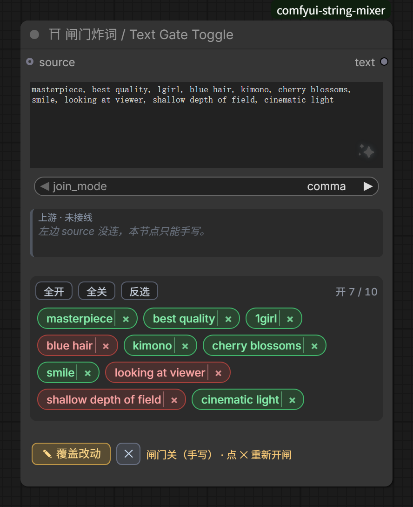

**它解决的问题**：上游给了一整句，你只想用其中一部分，而且下次可能想换另一部分。

**规则**：

- **框里空着** → 上游原样通过（不炸、不改标点）。
- **框里有字** → 按标点炸成词片；全开就输出原文；有关掉的就按分隔模式重拼；**全关则输出空**，并红字报警（避免静默出空提示词）。

**分隔模式**：`comma` 用 `", "` 重拼，`original` 保留原标点。

**绿/红和 × 是两件事**：点词片只是"这一轮用不用"（词还在）；点词右边的 `×` 才是**把这一段从文本框里彻底删掉**，标点也跟着带走。删完会出现「撤销删除」，10 秒内点一下就能原样放回来。

**方便在哪**：一次点击，就能在"上游全量"和"我挑过的子集"之间来回切。关掉的词留在原地变红，**不是删掉**——下次想开回来，点一下就回来，不用重新打。

**实际效果**：10 段关 3 段

```
输入：masterpiece, best quality, 1girl, blue hair, kimono, cherry blossoms, smile, looking at viewer, shallow depth of field, cinematic light
输出：masterpiece, best quality, 1girl, kimono, cherry blossoms, smile, cinematic light
```

---

## 💥 提示词炸词 / Prompt Toggle

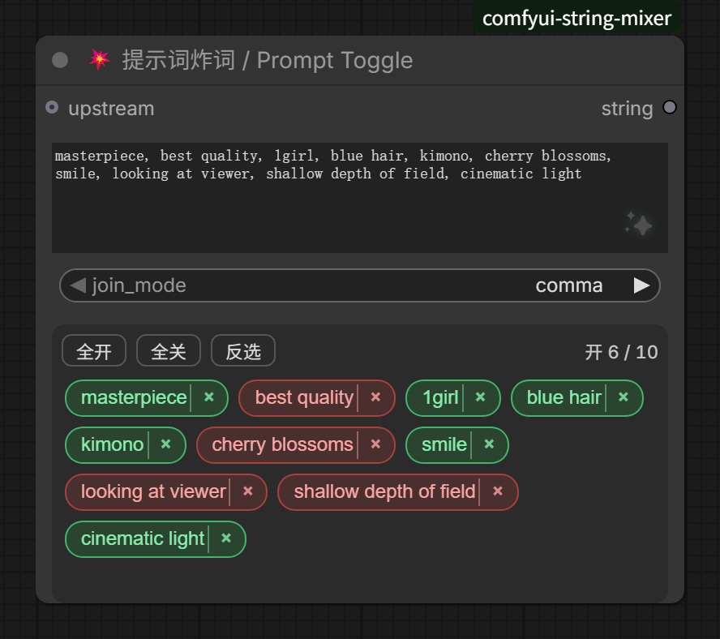

**它解决的问题**：手写一句提示词，想逐个试"这个词到底有没有用"。

**和闸门炸词的区别**：这个节点**不管上游**，只管框里这一句——纯粹的分词开关机。上游端口是可选的，接上就拼在你的结果前面（上游原样，不参与开关）。

**方便在哪**：不用复制粘贴到别的地方比对。关掉的词还在原地，试完开回来就是原句；真要删掉就用词片右上角的 `×`（10 秒内可撤销）。

```
输入：masterpiece, best quality, 1girl, blue hair, kimono, cherry blossoms, smile, looking at viewer, shallow depth of field, cinematic light
关掉：best quality / cherry blossoms / looking at viewer / shallow depth of field
输出：masterpiece, 1girl, blue hair, kimono, smile, cinematic light
```

---

## 🧵 文本混合 3 / 5 / 7

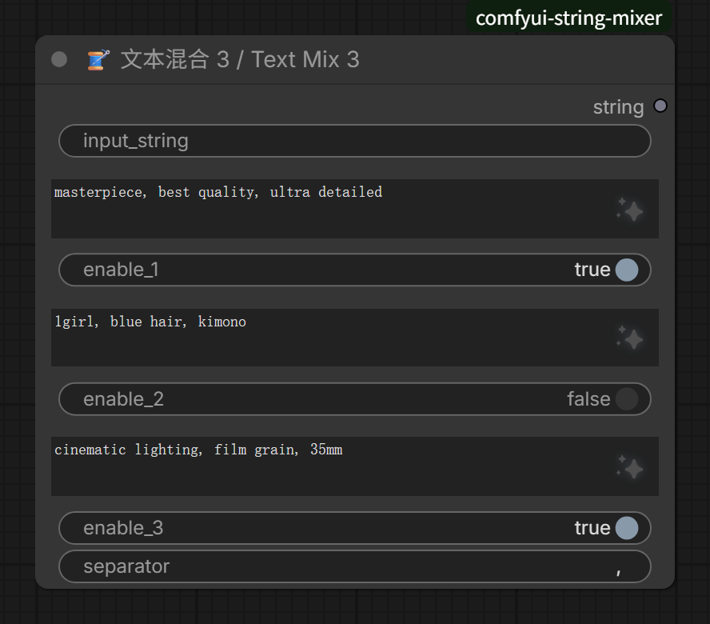

**它解决的问题**：提示词总是"质量词 + 主体 + 服装 + 场景 + 光线"拼起来的，全塞在一个框里，改一处要在一长串里找。

**规则**：顺序固定为 **外部输入 → 第 1 格 → 第 2 格 → …**；空格子跳过，关掉的格子整段跳过；分隔符默认一个空格，可以改成 `, `。

三个版本只是格子数不同（3 / 5 / 7），合并规则完全一样：

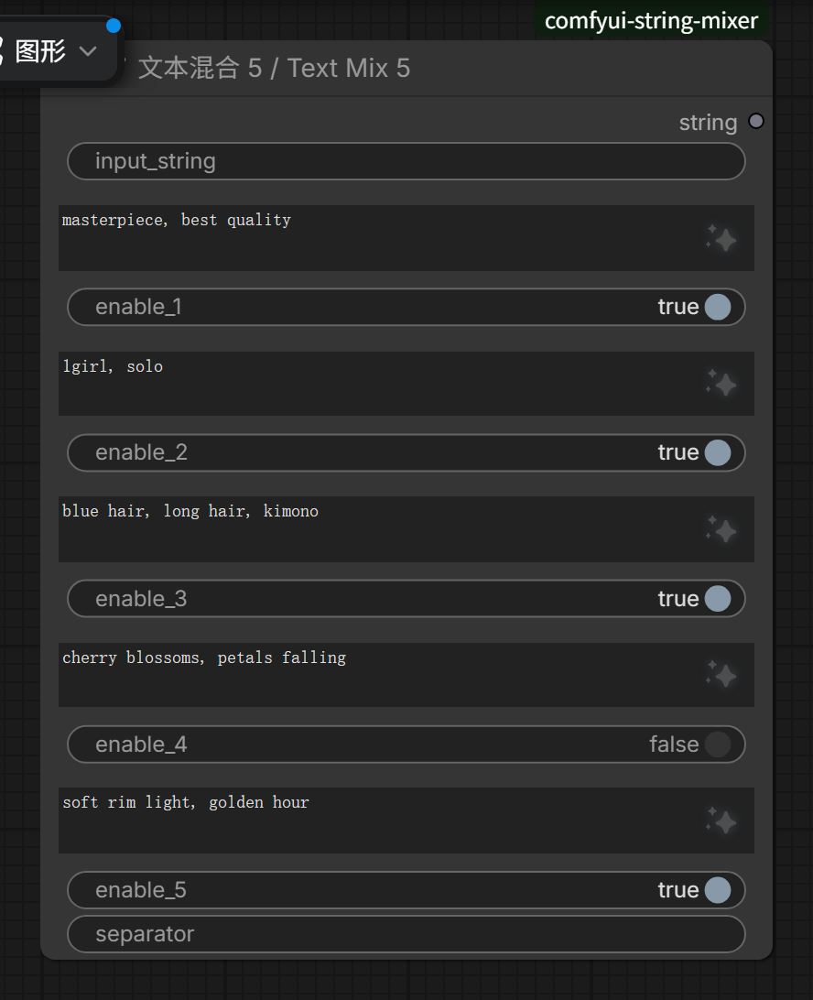
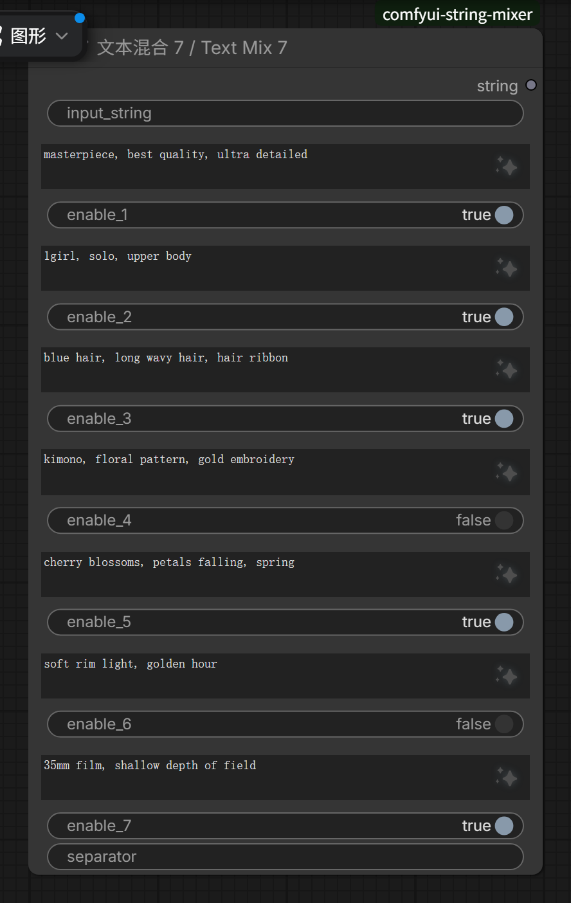

**方便在哪**：换服装只动第 3 格；试其他光线只动第 7 格然后开关一下。**同一套骨架可以在多个工作流里复用**，因为每格的内容都是明摆着的。

```
外部输入：（空）
第 1 格：masterpiece, best quality
第 2 格：1girl, blue hair        ← 关掉
第 3 格：cherry blossoms, soft light
分隔符：", "
输出：masterpiece, best quality, cherry blossoms, soft light
```

---

## 🧼 提示词净化 / Prompt Cleaner

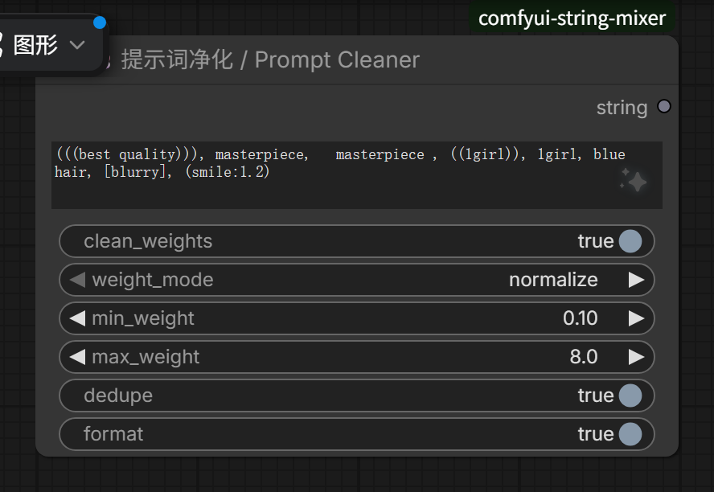

**它解决的问题**：从别处抄来的提示词带着一堆 `(((...)))`、重复词、三连空格、方括号，直接喂模型会莫名其妙地过曝或糊掉。

**四个开关各管一件事**：权重处理（归一化到区间 / 全部剥掉）、重复词去重、格式化（统一逗号与空格），以及权重的上下限。

**方便在哪**：不用记 `(word:1.2)` 这套语法，勾几个框就出干净的一句话；而且**改的是权重不是删词**——词还在，只是强度到了你能接受的区间。

```
输入：(((best quality))), masterpiece,   masterpiece , ((1girl)), 1girl, blue hair, [blurry], (smile:1.2)
输出：(best quality:1.21), masterpiece, (1girl:1.1), blue hair, (blurry:0.9), (smile:1.2)
```

---

## 📄 提示词文件 / Prompt File

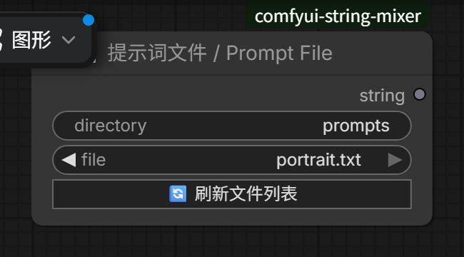

**它解决的问题**：好用的提示词散落在聊天记录、笔记、txt 里，每次都要开文件复制。

**怎么用**：`directory` 填目录（相对 ComfyUI 的 `input/`，留空就是 `input/prompts`），`file` 下拉里挑一个 `.txt`；目录里放过同名图片的话，鼠标移到节点上能看到缩略图。

**方便在哪**：提示词变成**文件**，就能版本管理、能分享、能在多个工作流里共用同一份。改文件即改所有引用它的工作流。

---

## 🎥 相机镜头 / Camera Rig

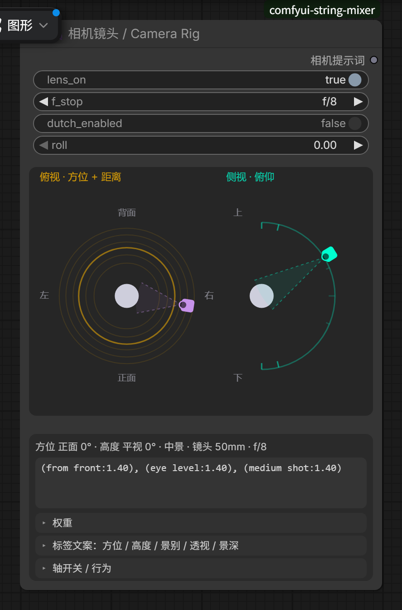

**它解决的问题**：镜头语言是英文模板的重灾区——`from above`、`high angle`、`cowboy shot`、`85mm`……记不住，写错还看不出来。

**怎么用**：左边是可视化的机位示意图（拖动即可），右边按"方位 / 高度 / 景别 / 透视 / 光圈 / 倾斜"分组。**预览行显示的就是排队时真正输出的那一行**，不是参考值。

**方便在哪**：所见即所得。你调的是"从右边、略高、中景"，节点给的是带权重的镜头词；权重模式可以选"保守上限"或"裸词"。

```
方位 = 右侧、高度 = 略高、景别 = 中景、焦距 50mm
输出：(from front:1.05), (from right:1.35), (high angle:1.14), (from above:1.14), (cowboy shot:1.40)
```

---

## ✍️ 技能写词 / 🧭 技能排版

这两个节点来自 `skillprompt` 子包，是"让 LLM 按固定规矩写提示词"的那一半；前面所有节点都不联网，只有它们需要 endpoint。

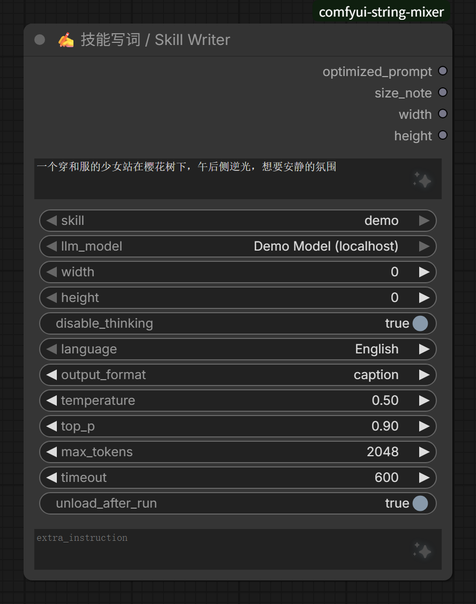

**技能写词**：你给一句人话需求（中文也行），它按选中的规则书（`SKILL.md`）和输出格式（`caption` / `tag` / `layout`）让 LLM 写出成稿。规则书决定"怎么写"，节点决定"调哪个模型"。

**方便在哪**：把"提示词的风格"从你的手感里搬进文件里。规矩改了改 `SKILL.md`，所有用到它的工作流一起变。

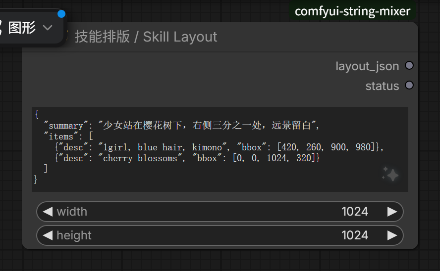

**技能排版**：纯本地、不联网。吃结构化布局（`summary` + 每个元素的 `box`），吐一行位置精确的布局提示词——位置用数字定，不靠 `left / right / center` 这种模糊词。

---

## SkillPrompt 配置

`skillprompt` 子包要两样东西：

**1. 一个 OpenAI 兼容的 endpoint**

```bash
cp skillprompt/skillprompt.ini.example skillprompt/skillprompt.ini
```

```ini
[lmstudio]
name = LM Studio 8B
base_url = http://127.0.0.1:1234/v1
model = qwen3-8b-instruct
```

每个 `[section]` 就是下拉里的一个选项；改完重启 ComfyUI。

> `skillprompt.ini` 里会有地址、可能有 key，**已在 `.gitignore` 里，不要提交**。

**2. 规则书**

```
skillprompt/skills/<名字>/SKILL.md
```

一个文件夹一本规则书，节点下拉里按文件夹名显示。仓库里自带的 `skillprompt/skills/demo/SKILL.md` 是个**空文件**，只用来演示目录结构——真正要用得自己写内容。

---

## 注意事项

- **节点类型名不会再变**（`StringMixer`、`TextGateSplit` 这些），已存的工作流升级后照常打开；改的只是显示名。
- **两个闸门是输出节点**：选中后点队列，只跑它和它的上游；其余节点跟着下游一起执行。
- **状态跟着工作流走**：闸门里写的字、关掉了哪些词、相机参数，都存在节点属性里，存进 `.json` 一起带走。
- **Python 改动要重启**，**前端改动只要 `Ctrl+Shift+R`**——分不清哪种就都做一遍。
- **README 的图是脚本拍的真界面**：`node tools/shots/shoot.mjs`（ComfyUI 在 `127.0.0.1:8199` 时）可以全部重拍，单个场景 `node tools/shots/shoot.mjs 02-gate-toggle`。

## License

MIT
